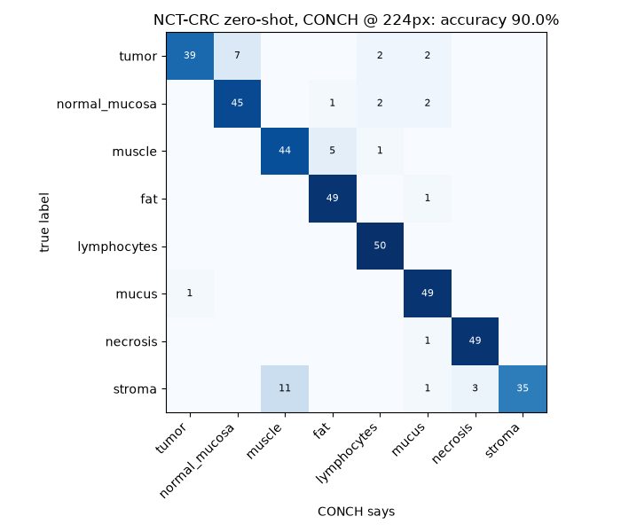
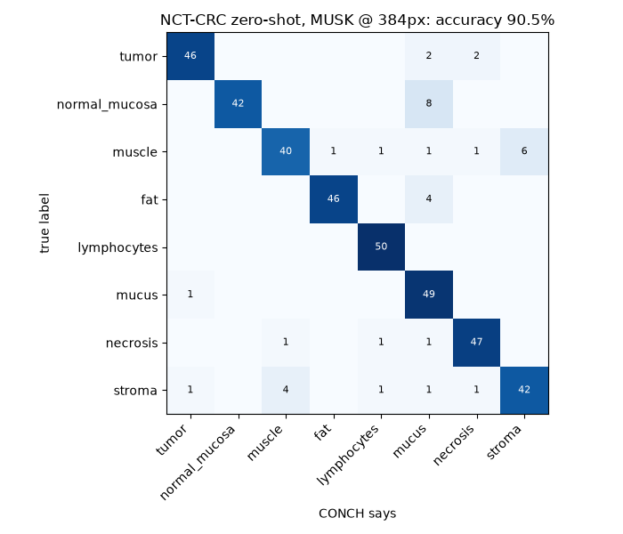

# Handoff: train the small tissue classifier

**Owner:** Models (role 2) · **Status:** not started · **Updated:** Sat Oct 17 (added MUSK results)

## TL;DR

We tested two models **zero-shot** (text prompts only, no training) on the same 400 labeled colon tiles:
**CONCH 90.0%**, **MUSK 90.5%**, and **averaging the two: 92.0%**. They fail in different places:
CONCH confuses **tumor → normal mucosa** and **stroma → muscle**; MUSK is much better at tumor (92% vs 78%) and stroma
(84% vs 70%) but worse at normal mucosa, muscle and fat. CONCH's probabilities are overconfident (it says ~1.00 even when
wrong); MUSK's are much more honest.

Your job: train a **logistic regression on the models' image embeddings** using the labeled NCT-CRC-HE-100K tiles, test it
on **different patients** (CRC-VAL-HE-7K), and compare it with zero-shot. Do this for **CONCH, MUSK, and both combined**.
The best option becomes the tissue classifier for the map.

This is a small job: one short GPU run (~15–20 min) to compute embeddings for both models, then everything else is CPU
(seconds).

---

## 1. Background: what we know so far

### What "embedding" and "logistic regression" mean here

- Each model turns an image tile into a list of numbers (an *embedding*) that summarizes what the tile looks like:
  **512 numbers for CONCH, 1024 for MUSK**.
- **Zero-shot** (what we do now): the model also turns text like "an H&E image of adenocarcinoma" into numbers, and each
  tile gets the class whose text is closest. No training.
- **Small classifier** (your job): use tiles that already have correct labels, and train a simple model (logistic regression,
  from scikit-learn) that maps the embedding → one of our 8 classes. CONCH/MUSK themselves are **not** retrained; they
  stay frozen. This usually fixes classes that the text prompts describe badly, and gives better-calibrated probabilities.

### Zero-shot results (same 400 NCT-CRC-HE-100K tiles, 50 per class, seed 0)

Jobs: CONCH `22953479`, MUSK `22954207` (1 A100 each, ~1.5 min each). Prompts `v1` (`src/prompts.py`).

| | CONCH @224 px | CONCH @448 px | MUSK @384 px | **CONCH224 + MUSK averaged** |
|---|---|---|---|---|
| **overall accuracy** | 90.0% | 88.8% | 90.5% | **92.0%** |
| tumor | 78% | 84% | **92%** | 88% |
| normal_mucosa | 90% | 82% | 84% | 92% |
| muscle | 88% | 86% | 80% | 90% |
| fat | 98% | 88% | 92% | 98% |
| lymphocytes | 100% | 100% | 100% | 100% |
| mucus | 98% | 94% | 98% | 98% |
| necrosis | 98% | 98% | 94% | 98% |
| stroma | 70% | 78% | **84%** | 72% |
| **log-loss** (lower = probabilities closer to the truth) | 0.71 | – | 0.33 | **0.26** |
| **avg confidence when wrong** (lower = more honest) | 0.88 | – | **0.60** | 0.63 |

Most common mistakes:
- **CONCH @224:** stroma → muscle 11/50, tumor → normal_mucosa 7/50, muscle → fat 5/50, stroma → necrosis 3/50.
- **MUSK:** normal_mucosa → mucus 8/50, muscle → stroma 6/50, stroma → muscle 4/50, fat → mucus 4/50.

Agreement: the two models give the **same answer on 87%** of tiles, and when they agree they're **right 96.8%** of the
time. At least one of them is right on 96.5% of tiles. So "the models disagree" is a useful uncertainty signal.

Confusion matrices (rows = true class, columns = model's answer):

| CONCH @224 px | MUSK @384 px |
|---|---|
|  |  |

**How sure are these numbers?** 50 tiles per class means each per-class number is roughly ±6%. CONCH vs MUSK overall
(90.0 vs 90.5) is a tie; the tumor (78 → 92) and stroma (70 → 84) gaps are 7 tiles each, which is more convincing but
should be confirmed on the full test set (your job).

### PathGen patches (16 colorectal patches with AI-written captions)

Our rough reading of the captions (they're AI-generated, **not** ground truth): each model matched the caption on about
**10/16**, but not the same 10.
- MUSK fixed two cancer patches that CONCH called normal with ~1.00 confidence (#1 → tumor 0.78, #8 → tumor 0.88).
- CONCH got two muscle/connective patches that MUSK missed (#6 vessel + connective tissue: CONCH stroma, MUSK muscle;
  #11 smooth muscle: CONCH muscle, MUSK stroma).
- Both models called two patches "tumor" whose captions say normal mucosa (#12, #13). Unclear who's right; a pathologist
  should look.
- #5 is almost entirely **red blood cells**: CONCH said necrosis 1.00, MUSK said fat 0.66. We have no blood class.

### Whole slide (TCGA-A6-3809, T4 stage IIB, 16 random tissue patches, 112 µm each)

- The tissue mask works (skips glass, pen smudge, scratches). This slide has **3 serial sections** side by side.
- Both models call most patches tumor (as expected for a T4 cancer); they agree on 12/16.
- Disagreements: #2 (mostly blood): CONCH necrosis 0.97, MUSK tumor 0.78. #8 (dark edge of a tumor gland next to glass):
  CONCH lymphocytes 0.99 (wrong), MUSK mucus 0.45 (unsure). #1 and #10: mucus vs necrosis (debris inside glands).
- MUSK's probabilities on the slide are 0.6–0.95 where CONCH says 0.99–1.00.

### Takeaways for your work

1. **Train on both models' embeddings.** They make different mistakes, so a classifier on CONCH + MUSK combined
   (512 + 1024 = 1536 numbers per tile) may beat either alone. Compare all three.
2. **Report calibration, not just accuracy.** The app shows probabilities on hover; MUSK's honesty is a real advantage.
3. Real slides will be harder: NCT-CRC-HE-100K is **color-normalized**, real TCGA slides vary a lot (pale lilac to deep
   purple).
4. NCT-CRC has **no blood class**, so a classifier trained on it will still force blood into one of the 8 classes.

### Our 8 classes, in order (this order is the column order everywhere: `p_tumor, p_normal_mucosa, ...`)

`src/prompts.py` → `CLASSES = ["tumor", "normal_mucosa", "muscle", "fat", "lymphocytes", "mucus", "necrosis", "stroma"]`

NCT-CRC folder → our class (`src/datasets.py` → `NCT_TO_CLASS`):
`TUM→tumor, NORM→normal_mucosa, MUS→muscle, ADI→fat, LYM→lymphocytes, MUC→mucus, DEB→necrosis, STR→stroma`.
`BACK` (empty glass) is skipped, because our tissue mask removes background before classification.

### Where the raw results are

- On Delta: `~natmakur/Ashby-/data/results/first_look/` (CONCH) and `.../first_look_musk/` (MUSK). These are in a
  private home folder, so ask whoever ran them (Delta user `natmakur`) for copies. Each has `metrics.json`, `nct_*_predictions.csv` (per-tile
  probabilities), confusion matrices, example grids, PathGen and slide results.
- Reproduce them yourself (~1.5 min GPU each): `sbatch scripts/first_look_gpu.sbatch` (CONCH) or
  `sbatch scripts/first_look_gpu.sbatch musk`.

---

## 2. Data

| set | where | what | use it for |
|---|---|---|---|
| **NCT-CRC-HE-100K** | `/projects/bfqi/shared/datasets/NCT-CRC-HE-100K/data-samples/<CLASS>/*.tif` (on Delta) | ~89k labeled tiles (excluding BACK), 224×224 px at 0.5 µm/px, color-normalized, from 86 slides | **training** |
| **CRC-VAL-HE-7K** | not on Delta; download (below) | 7,180 labeled tiles from **50 different patients** (no overlap with the 100K set), same size/classes | **testing** |
| our TCGA slides | `/work/hdd/bfqi/natmakur/tcga_slides/` | 5 whole slides (+ `slides.csv` with stage) | stretch: real-slide check |
| **STARC-9 subset** | `scripts/get_starc9.py` → `data/datasets/starc9/` | 90k training tiles (~200 Stanford patients, our 8 classes + blood) + 3 separate-patient test sets incl. TCGA | extra training + honest testing; see `docs/dataset_starc9.md` |

Download the test set once, on a Delta **login node** (free, no GPU), into your own work folder:

```bash
mkdir -p /work/hdd/bfqi/$USER/datasets && cd /work/hdd/bfqi/$USER/datasets
curl -L -o CRC-VAL-HE-7K.zip "https://zenodo.org/api/records/1214456/files/CRC-VAL-HE-7K.zip/content"   # 0.8 GB
unzip -q CRC-VAL-HE-7K.zip && ls CRC-VAL-HE-7K      # expect ADI BACK DEB LYM MUC MUS NORM STR TUM
```

(Source: Zenodo record 1214456, Kather et al., license CC-BY 4.0. If the long download gets cut off on the login node,
run it with `nohup ... &` and check back.)

**Why a separate test set matters:** NCT-CRC-HE-100K has no patient IDs, so a random train/test split would put tiles
from the *same patient* in both, and the score would look better than it really is. Our rule is: always split by patient.
CRC-VAL-HE-7K has no patient overlap, so testing on it gives an honest number.

---

## 3. Steps

### Step 0: Delta setup (once, in your own Delta account)

Follow README → "Saturday on Delta" (or the SSH route if Open OnDemand is slow). The short version:

```bash
# repo in your HOME folder (private). The GitHub repo is private: clone with a GitHub personal access token.
cd ~ && git clone https://github.com/PSMacaroni/Ashby-.git && cd Ashby-
source scripts/delta_env.sh            # EVERY new terminal/job: loads Delta's PyTorch + our packages
pip install --user -r requirements.txt
cp .env.example .env && chmod 600 .env
nano .env   # HF_TOKEN=<yours>, DATA_DIR=/projects/bfqi/shared/datasets, HF_HOME=/projects/bfqi/$USER/hf_cache
mkdir -p /projects/bfqi/$USER/hf_cache && chmod 700 /projects/bfqi/$USER/hf_cache
python scripts/check_setup.py          # everything OK except "No GPU" on the login node
```

Download both models' weights on the login node first (free; otherwise the GPU job spends paid time downloading):

```bash
python -c "
from src import config; from huggingface_hub import hf_hub_download as d
d('MahmoodLab/conch', 'pytorch_model.bin', token=config.HF_TOKEN)
d('xiangjx/musk', 'model.safetensors', token=config.HF_TOKEN); d('xiangjx/musk', 'tokenizer.spm', token=config.HF_TOKEN)"
```

Gotchas we already hit (already fixed in the repo, but good to know):
- Delta's PyTorch module hides `pip install --user` packages → that's why `delta_env.sh` exists.
- Delta's own matplotlib crashes drawing text → `requirements.txt` installs a working one.
- `transformers` 5.x broke CONCH's text tokenizer **and** MUSK's (`XLMRobertaTokenizer(path)` fails) →
  `src/models.py` has a fixed `tokenize()` for CONCH and `MuskTokenizer` for MUSK (checked identical to the old
  tokenizer on 139 test strings).
- MUSK's own loader saves weights to `~/.cache` (small on Delta); our `load_musk()` uses `HF_HOME` instead.
- Long commands on the **login node** get killed → run anything long as a job, or with `nohup`.
- `/projects/bfqi/<you>` and `/work/hdd/bfqi/<you>` are readable by **everyone in the hackathon**. Keep `.env` in `~`.

### Step 1: compute embeddings (GPU, one short job)

Write `scripts/embed_tiles.py` that, for a folder of NCT-style tiles (`<CLASS>/*.tif`) and a `--model conch|musk`:
1. loads the model once: `load_conch(image_size=224)` or `load_musk()` (both in `src/models.py`, both return
   `(model, preprocess)` with the same interface)
2. reads tiles with a PyTorch `DataLoader` (`num_workers=8`) so file reading runs in parallel. **Don't** load all 89k
   images into a Python list first: that's ~13 GB of RAM.
3. runs `model.encode_image(batch.to("cuda"), proj_contrast=True, normalize=True)` under `torch.inference_mode()`.
   This works for both models (the MUSK wrapper ignores the CONCH-only arguments) and is exactly what
   `classify_images()` does, so the embeddings match the zero-shot pipeline. MUSK runs in float16 on GPU; the
   wrapper returns float32.
4. saves one `.npz` per model per dataset: `embeddings` (float32, [N, 512] for CONCH, [N, 1024] for MUSK),
   `labels` (int, index into `CLASSES`), `paths` (str), plus `text_emb = build_text_classifier(model).cpu().numpy()`
   and `logit_scale = model.logit_scale.exp().item()`. Saving `text_emb` and `logit_scale` means you can recompute
   zero-shot probabilities later **on CPU**: `softmax(logit_scale * embeddings @ text_emb.T)`.
   **Keep the tile order identical** across the two models' files (same `paths` order) so you can combine them.

Rough shape (fill in the details):

```python
class Tiles(torch.utils.data.Dataset):
    def __init__(self, items, preprocess):           # items = [(path, class_name), ...]
        self.items, self.preprocess = items, preprocess
    def __len__(self):
        return len(self.items)
    def __getitem__(self, i):
        path, cls = self.items[i]
        return self.preprocess(load_rgb(path)), CLASSES.index(cls)

loader = DataLoader(Tiles(items, preprocess), batch_size=256, num_workers=8)   # MUSK: batch_size=64 is safer
with torch.inference_mode():
    for x, y in tqdm(loader):
        emb = model.encode_image(x.to("cuda"), proj_contrast=True, normalize=True)
        ...
```

`src/datasets.py` → `sample_nct(nct_dir, n_per_class)` already lists tiles per class; for "all tiles" pass a big
`n_per_class` (it caps at what exists), or add a small helper.

**Test it small first:** run on your laptop or a login node with `--n-per-class 5` and `device="cpu"` to catch bugs
without spending GPU time (MUSK works on CPU too, just slowly). Then on GPU, run 1,000 per class (~8k tiles) to check
speed, then all of NCT-CRC-HE-100K (minus BACK) + all of CRC-VAL-HE-7K (minus BACK), for both models, in one job.
MUSK is a bigger model at a bigger image size: expect it to take roughly **3–4× longer than CONCH**.

Submit with a copy of `scripts/first_look_gpu.sbatch` (change the job name and the `python ...` line). That file already
has the right account (`bfqi-delta-gpu`), partition (`gpuA100x4`, hackathon reservation), 1 GPU, 8 CPUs, 32 GB.
Bump `--time` to `01:00:00`. You're billed for the time actually used, not the limit.

Save outputs to `/projects/bfqi/$USER/embeddings/` (big, git-ignored type `.npz`; fine to share since it's from public data).
89k tiles: ~180 MB (CONCH) and ~360 MB (MUSK) as float32.

**GPU budget:** the whole team has **10 GPU-hours total** (`accounts` shows the balance; ~0.1 used so far). This job
should take well under 0.5 hours. **Tell the team before you submit anything on GPU.**

### Step 2: train + evaluate (CPU only, seconds; laptop or a CPU job)

Write `scripts/train_classifier.py`. Train **three** classifiers on NCT-CRC-HE-100K:
(a) CONCH embeddings, (b) MUSK embeddings, (c) both concatenated (`np.hstack([conch, musk])`, 1536 numbers).

```python
from sklearn.linear_model import LogisticRegression
clf = LogisticRegression(C=1.0, max_iter=3000, class_weight="balanced")
clf.fit(X_train, y_train)          # X = embeddings from NCT-CRC-HE-100K, y = labels
probs = clf.predict_proba(X_test)  # X_test = CRC-VAL-HE-7K
```

- Columns of `predict_proba` follow `clf.classes_`. Make sure that's `[0..7]`, i.e. **CLASSES order**.
- Try a few `C` values (e.g. 0.1, 1, 10) using a validation split of the **training** set, not the test set.
- Then evaluate **once** on CRC-VAL-HE-7K and report all of these on the **same** test tiles:
  zero-shot CONCH, zero-shot MUSK, zero-shot average, LR-CONCH, LR-MUSK, LR-both. For each: overall accuracy,
  balanced accuracy, per-class accuracy, log-loss, confusion matrix (PNG + CSV; reuse `confusion_matrix` /
  `save_confusion` from `scripts/first_look.py`).
- **Calibration** (is "0.9" right ~90% of the time?): report log-loss, and ideally a reliability plot
  (bin by confidence, plot accuracy per bin). The app shows these probabilities on hover, so this matters.
- **Disagreement as uncertainty:** for zero-shot, how accurate are tiles where CONCH and MUSK agree vs disagree?
  (On our 400 tiles: agree 87% of the time, 96.8% accurate when they agree.)
- Training on 89k × 1536 takes seconds to a few minutes on CPU. Don't run it on a login node; use your laptop
  (copy the `.npz` files down) or a CPU job (`bfqi-delta-cpu`, see `scripts/first_look_cpu.sbatch`).

Save the trained model(s) with `joblib.dump(clf, ...)` to `/projects/bfqi/$USER/models/` (e.g. `lr_conch_musk_v1.joblib`)
and write down the exact settings (which embeddings, C, data, date) next to it.

### Step 3: make it usable by the pipeline

Add `src/classifier.py` with:

```python
def load_classifier(path): ...            # joblib.load
def predict_proba(clf, embeddings): ...   # -> numpy [n, 8], columns in CLASSES order, rows sum to 1
```

The pipeline already gets embeddings from `classify_images()` (it returns `probs, image_embeddings`), so swapping
zero-shot for the classifier is one line (or two calls + `np.hstack` for the combined version). In `summary.json`, set
`"model": {"name": "CONCH + MUSK + logistic regression v1", ...}`.

### Step 4: nerve and artery detectors (we are doing these)

Same recipe as the 8-class classifier, but one **yes/no** classifier per structure, because a tile can be
"fat" *and* contain a nerve:
1. Find candidates with text search on a few TCGA slides (phrases in `src/phrases.py`: `nerve`, `artery`),
   top ~50 each, and have the pathologist mark each tile yes/no (aim for 30–50 yes per structure).
2. Fit `LogisticRegression` (yes vs no) on the same embeddings; check precision on held-out labeled tiles.
3. In the whole-slide pipeline, write the probabilities into `tiles.csv` as **`p_nerve`** and **`p_artery`**
   (0–1). `scripts/analyze_slide.py` picks them up automatically: the perineural and venous flags then
   use the detectors instead of the weaker text phrases (see `src/flags.py`). Nothing else to change.

Main look-alike to include as "no": smooth muscle (for nerves) and veins/stroma (for arteries).

### Stretch: check on our real TCGA slides

Accuracy on NCT-CRC isn't the same as accuracy on real slides. If there's time: hand-label ~100 tiles from our TCGA
slides (the plan in `CLAUDE.md` → "Validation we want for judges"), then compare zero-shot vs classifier on them.
Get a pathologist/mentor to check a few labels if possible.

---

## 4. What "done" looks like (report back with)

- [ ] `scripts/embed_tiles.py`, `scripts/train_classifier.py`, `src/classifier.py` pushed on a branch + PR
- [ ] Table on CRC-VAL-HE-7K: zero-shot CONCH / MUSK / average vs LR-CONCH / LR-MUSK / LR-both: overall, balanced,
      per-class accuracy, log-loss
- [ ] Confusion matrices (PNG). Did **tumor→normal** and **stroma→muscle** improve?
- [ ] Recommendation: which option should the tissue map use?
- [ ] Path to the saved classifier(s) + embeddings on Delta, and the settings used
- [ ] GPU time used (`sacct -j <jobid> -X -o JobID,Elapsed,State`)
- [ ] A 2–3 sentence takeaway we can put on a slide (honest: trained on color-normalized tiles from one hospital)

## 5. Open questions (decide with the team)

1. **Which model for the map:** zero-shot average of CONCH + MUSK (no training, 92% here) vs a trained classifier.
   Your results decide this. MUSK costs ~3–4× more GPU time per tile than CONCH.
2. **Blood:** NCT-CRC has no blood class, so the classifier will still force blood into one of the 8 classes. Options:
   add "blood" as a zero-shot-only class, or flag tiles where the top probability is low (or the models disagree) as
   "uncertain".
3. **Color normalization:** train on the normalized 100K set (on Delta) or the non-normalized `NCT-CRC-HE-100K-NONORM`
   (11.7 GB on the same Zenodo page)? Non-normalized may transfer better to real TCGA slides, but it's a bigger download.
   Start with what's on Delta; try NONORM only if real-slide results are poor.
4. Should background (`BACK`) become a 9th class to catch tiles the tissue mask lets through? Probably not needed yet.

## 6. Where things are

| what | where |
|---|---|
| CONCH + MUSK loading, zero-shot, embeddings | `src/models.py` (`load_conch`, `load_musk`, `build_text_classifier`, `classify_images`) |
| class list + prompts | `src/prompts.py` |
| NCT-CRC / PathGen readers + class mapping | `src/datasets.py` |
| example GPU / CPU job files | `scripts/first_look_gpu.sbatch` (`... musk` for MUSK), `scripts/first_look_cpu.sbatch` |
| first-look script (confusion-matrix code to reuse) | `scripts/first_look.py` (`--model conch|musk`) |
| Delta accounts, paths, rules | `CLAUDE.md` → "Delta specifics" |
| project rules (honest limits, data contract) | `CLAUDE.md` |
